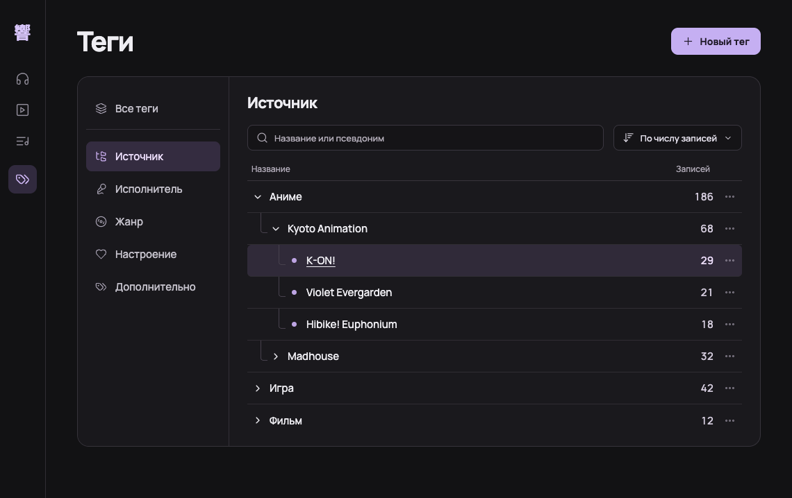

# Свой видеоряд, быстрый старт и каталог тегов

Черновик для обсуждения · 26 ноября 2026 года. Владелец задал три сценария. В P01–P02 зафиксированы решения владельца. Правила старта и проект каталога остаются предложениями. [Техническая спецификация](tech.md)

## 1. Клип для своей композиции

**P01. Что делает команда агента. Решение владельца.** «Вставь видео из моего клипа в эту песню» означает, что Hibiki выделяет на сервере только картинку клипа и привязывает её к текущему звуку песни. Тот же запрос для концертного видео сохраняет звук концерта. Видеоряд можно взять из собственной записи или передать новым файлом. Агент получает результат с названием целевой песни и выбранными дорожками. Пока идёт подготовка, доступна прежняя версия.

Пользователь видит одну композицию с прежним названием, ID, тегами, избранным, историей и местом в плейлистах. В её карточке доступны «Звук», «Видеоряд», «Заменить клип» и «Вернуть оригинал». В мини-плеере появляется «Смотреть клип». Один и тот же клип можно назначить нескольким песням. Дорожки хранятся на бэкенде, отдельная вкладка для видео без звука и новые карточки при прикреплении не создаются. Если донор уже был самостоятельной записью, он по-прежнему доступен со своим звуком.

Граница первой версии для обсуждения — собственные локальные материалы в поддерживаемых форматах. Ролик YouTube подходит после штатной загрузки разрешённой локальной копии. Агент сообщает о недоступной дорожке или предлагает выбрать одну из нескольких. Исходный тип записи определяет её место в фильтрах медиатеки.

**P02. Как смотрят клип. Решение владельца.** Звук задаёт общую шкалу. Короткий видеоряд повторяется до конца песни. Действующая ссылка на запись открывает песню с текущим клипом, включая ссылку, выданную до его прикрепления. При запуске со страницы такой ссылки получатель видит клип и слышит песню. В личной медиатеке нажатие обложки запускает звук, а «Смотреть клип» включает картинку с нужного места. Пауза и перемотка управляют обеими дорожками.

| Ситуация | Поведение |
|---|---|
| Клип 30 секунд, песня 3 минуты | Клип проходит шесть раз. При переходе на 1:20 видна 20-я секунда клипа. В 3:00 очередь продвигается один раз. |
| Клип 4 минуты, песня 3 минуты | Просмотр заканчивается вместе со звуком в 3:00. |
| Картинка долго загружается или недоступна | Песня продолжает играть. Обложка и статус картинки позволяют повторить попытку. После загрузки отображается кадр текущего повтора. |
| Владелец прикрепил, заменил или снял клип | При следующем открытии или запуске по тому же адресу получатель видит актуальный результат. После снятия возвращается исходное видео или обложка песни. При редактировании сохраняются адреса действующих ссылок и сроки доступа. |
| Запись входит в общий плейлист | У получателя с доступом к позиции открывается та же версия композиции. Ограничения исходной ссылки, включая отзыв и разрешение на повторную раздачу, действуют для обеих дорожек. |

Для первого выпуска предлагаю один клип с началом в нулевой точке. Смещение, монтаж нескольких фрагментов и экспорт готового смонтированного фильма — отдельные задачи.

## 2. Быстрый старт из медиатеки

**P03. Что видно до первого звука.** Владелец наблюдает последовательность «Только звук» → «Загрузка…» → слышно песню, причём полоса успевает продвинуться. Предлагаю при нажатии сразу выделять выбранную запись и давать отменить запуск. При быстром ответе промежуточный текст не нужен. При ожидании дольше 300 мс показываем «Загрузка…» один раз. «Только звук» остаётся названием режима у переключателя. «Сейчас играет» появляется после подтверждённого старта движка, «Буферизация…» — при остановке уже начавшегося трека.

Яркая шкала и её бегунок показывают подтверждённую позицию ведущего звука. Во время ожидания может расти лишь приглушённый запас загрузки. Прежний трек, буфер и запоздалое событие не сдвигают позицию нового. Явная перемотка доступна. Тихое авторское вступление проигрывается целиком.

Возможны смена индикации и ускорение доставки первых аудиоданных. Предлагаю проверить оба слоя. На локальном MP3 при искусственной задержке медиа контрольная серия воспроизвела ожидание около секунды. Цветная полоса позиции при этом оставалась на нуле до старта. В одном предварительном прогоне без искусственной задержки браузер сообщил о воспроизведении примерно за 1,3 с до первого обнаруженного сигнала. В отдельном сравнении с активным аудиовыходом ручной выбор одного и того же MP3 дал 28–45 мс до тона, когда его начало уже было в памяти, и 874–896 мс при холодном запросе с искусственной задержкой сервера 850 мс. Поэтому предлагаю готовить начало трека, на котором пользователь задержал указатель или фокус. Причину задержки на устройстве владельца предстоит измерить. [Методика и наблюдения](tech.md#наблюдения-на-стенде)

**P04. Что означает «почти мгновенно».** Предлагаемые цели для воспроизводимых собственных файлов, в активной вкладке, при уже открытой медиатеке. Таймер запускаем с клика. На сигнале с известным началом останавливаем его по первым ненулевым звуковым отсчётам. Числа ниже — критерии приёмки, результат предстоит измерить.

| Условия | Предлагаемая цель |
|---|---|
| Начало конкретного трека уже в памяти, вывод звука активен | В 95% запусков сигнал появляется за 100 мс |
| Файл ещё не запрашивался, RTT около 50 мс, доступно 20 Мбит/с, вывод активен | Медиана до 150 мс, p95 до 300 мс для обычного MP3, M4A с индексом в конце и звука из поддерживаемого MP4. Для большого M4A первый бюджет p95 — 450 мс. |
| Первый звук после простоя устройства | Отдельный результат с типом аудиовыхода. Проверяем на том устройстве и с тем треком, где слышна секунда ожидания. |

Ускорение должно сохранять исходное качество и первые ноты. Полное буферирование поддерживаемого текущего трека, подготовленный следующий трек и самостоятельная работа кнопки с клавиатуры входят в приёмку. Открывать внешний плеер YouTube или ждать кадр AMV для начала прослушивания своей песни не требуется.

## 3. Вкладка «Теги»

**P05. Как устроен каталог.** Предлагаю отдельную просторную страницу по существующему адресу вкладки. Слева — «Все теги» и пять разделов. Справа — поиск, сортировка и строки выбранного раздела. Так видно и место в коллекции, и достаточно длинные названия. Альтернатива — единая сетка карточек с выпадающим фильтром категории, как сейчас.

*Макет для обсуждения. Названия и числа иллюстрируют взаимодействие.*

- **Стрелка** перед родителем раскрывает дочерние теги на месте. У «Источника» может быть несколько путей к одному произведению. «Исполнитель», «Жанр», «Настроение» и «Дополнительно» — плоские разделы. «Исполнение» и голоса остаются свойствами записи.
- **Название тега** открывает медиатеку с единственным выбранным тегом. «Kyoto Animation» включает её произведения. Уходят прежний текст, фильтры и ограничение «Недавно слушал». Личный порядок выдачи сохраняется, если он показывает все записи. «Назад» возвращает раздел, сортировку, раскрытые ветки, поиск, прокрутку и фокус на тег.
- **Меню строки** открывает редактирование и удаление с подтверждением. В редакторе доступны название, цвет, раздел, псевдонимы, родители и заметка. «Новый тег» подставляет открытый раздел. Кнопка создания, поиск и сортировка доступны при прокрутке. Перенос прежней классификации доступен из действий каталога.
- В «Все теги» и результатах поиска каждое значение показано один раз, рядом виден путь. Псевдоним KyoAni находит Kyoto Animation. Поиск сохраняет совпадения по пути и личной заметке. При одинаковом имени путь поясняет, какой именно тег будет открыт. Пустой раздел предлагает создать тег, пустой поиск — изменить или очистить запрос.
- На узком экране список разделов открывается над выдачей. Текущий раздел остаётся в заголовке. Enter открывает имя, Enter или пробел раскрывает стрелку, Escape закрывает меню и возвращает фокус. Мини-плеер не перекрывает последнюю строку.

**P06. Что такое «самый добавляемый».** Предлагаю два порядка — «По числу записей» по убыванию и «По алфавиту». Первый открывается по умолчанию, затем запоминается выбор пользователя. Справа показано число уникальных записей, которые откроются при нажатии сейчас. У родителя учитываются потомки. Запись в двух дочерних ветках считается один раз. В дереве сортируются соседи одного уровня, в поиске и «Все теги» — вся видимая выдача. При равенстве идут имя и стабильный ID. Теги с нулём остаются доступны.

Другая трактовка — частота ручных назначений за период. Она отвечала бы на вопрос «что я в последнее время чаще добавляю» и потребовала бы истории операций. Для предложенного каталога цифру рядом с тегом можно сразу проверить переходом в медиатеку.

## Приёмка владельцем

1. Агент прикрепляет один шумный клип к MP3, затем к исходному видео с речью. В обоих случаях слышен только выбранный оригинал. Проверить перемотку, конец короткого клипа, как минимум два повтора, замену и снятие. Открыть ссылку, созданную до назначения, и новую ссылку под вторым аккаунтом. Прикрепить клип к третьей песне, убедиться, что лишних карточек не появилось и за прослушивание учтена одна запись истории.
2. Запустить из медиатеки холодный трек, подготовленный трек и два трека быстрыми последовательными кликами. Сверить первый сигнал с целями, движение ползунка со статусом и проигрываемую запись с последним кликом.
3. Открыть «Источник», найти KyoAni, раскрыть произведения, сменить сортировку, открыть тег и вернуться назад. Создать и переименовать пробный тег, затем удалить его из меню. Проверить, что цифра равна числу найденных записей, в том числе для родителя с пересекающимися ветками.

На обсуждении — целевые времена старта, значение популярности и первоначальный порядок каталога.
